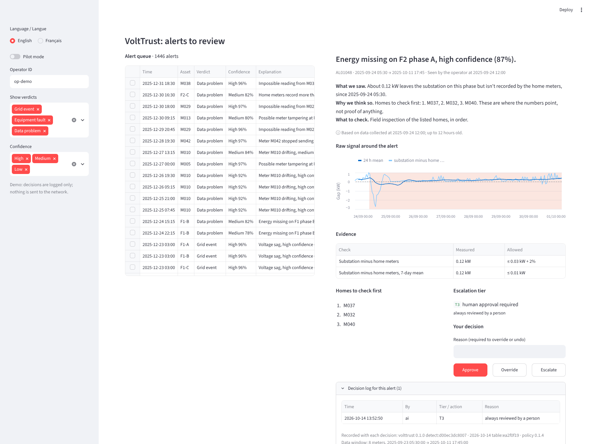

# Voltrust Tunisia

**Checking energy data before anyone acts on it.** TSYP14 Technical Challenge, *Architects of the Energy Noosphere*, Phase 1.

## What is it?

Voltrust is an AI trust layer for smart-grid data.

Smart meters are arriving in Tunisian homes, and utilities will soon act on their readings automatically. But a reading can be wrong: a sensor drifts, a meter is tampered with, a reading never arrives, or someone injects false data. VoltTrust sits between the raw data and any automatic action. For every alert it answers three questions:

1. **What happened?** A real grid event, an equipment fault, or a data problem.
2. **How sure are we?** A confidence score measured from past results, with a short explanation in English or French.
3. **Who decides?** The system acts alone only when it is safe to; otherwise a person decides, and every decision is logged.

The main idea is simple: **the neighbors are witnesses.** When every meter on a feeder moves together, the grid moved. When one meter disagrees with the others on its phase, that meter is wrong. When one solar home produces less than the others in the same sunshine, its panels are the problem.



## What did we build?

A single-node Tunisian neighborhood simulation, a detector, explanations, an escalation router and an operator dashboard.

| | |
|---|---|
| **A dataset** | One simulated year (2025) of a neighborhood near Tunis, at 15-minute resolution: one 100 kVA substation, two low-voltage feeders, 48 homes, 14 of them with rooftop solar. It is driven by the real 2025 Tunis weather and contains 208 labelled problems of 28 types. |
| **A detector** | Physics checks, an Isolation Forest, and a rule table that gives every alert a verdict, a measured confidence and an explanation. |
| **An escalation router** | Sends each alert to one of five levels of human control, and keeps a tamper-evident decision log. |
| **An operator dashboard** | One Streamlit screen in English and French to review, approve or override alerts. |

## What are the results?

**94% of problems detected, 98% right verdicts, 0.11 false alerts per feeder per day, and 8 of 8 unseen attacks caught.**

Measured on a fresh dataset (seed 2026) that was never used for tuning. An event counts as detected when an alert starts on one of its assets while it is happening.

| Measure | Target | Test months, seed 42 | Test months, fresh seed 2026 |
|---|---|---|---|
| Problems detected (recall) | ≥ 0.90 | 0.91 | **0.94** |
| Right verdict, when detected | ≥ 0.85 | 0.99 | **0.98** |
| False alerts per feeder per day | ≤ 1 | 0.05 | **0.11** |
| Alert precision | | 0.98 | 0.96 |
| Theft: right home among the 3 to check | ≥ 0.70 | 0.76 | 0.76 |
| Confidence calibration error | ≤ 0.08 | 0.075 | 0.054 |
| Processing time | < 1 s | about 1 ms for all 48 meters | |

Both unseen attacks (replayed readings and coordinated false data) were caught every time, and all 36 solar panel problems were found with the right verdict. Detailed results are in `results/`, and the two notebooks walk through them.

**Known limits.** Problems on the current sensor keep the power equation intact, so they show only in the phase balance: they are caught, but slowly, and point to a phase rather than a home. A failing cooling system on the lightly loaded transformer is hard to see without an oil sensor. About 10% of readings are never collected, as in a real system, and some short events fall entirely inside those gaps.

## How do I run it?

Python 3.10 or later.

```bash
# 1. install
pip install -r requirements.txt

# 2. generate the dataset (about 10 s; data/ already holds seed 42)
PYTHONPATH=src python -m volttrust.sim.simulate --out data --seed 42

# 3. run the detector and score it (about 40 s)
PYTHONPATH=src python -m volttrust.detect.run --data data --out results

# 4. open the operator dashboard
streamlit run app/dashboard.py
```

To check everything works: `python -m pytest -q`.

`python -m volttrust.detect.run --help` lists the equipment options: with or without a substation meter, with STEG's phase map or with phases inferred from the data, with or without a transformer oil sensor.

---

# Going deeper

## How the data is made

Real grid data with labelled faults is very rare, so we simulate it in two layers.

1. **The physical neighborhood.** Each home's consumption follows the real hourly Tunis weather (air conditioning, heating, lighting), the 2025 calendar (Ramadan, holidays, the July heatwave) and its own rooftop solar. A power flow then computes the voltages and currents on every feeder. Grid events and equipment faults are injected here, so every sensor sees them consistently.
2. **The meters.** Each meter adds its normal measurement noise. Data problems (drift, bias, frozen values, spikes, missing readings, replayed or falsified readings) change only what one meter *reports*. The true values are kept next to the reported ones.

The data also matches what the Tunisian utility (STEG) really collects: readings arrive in 12-hour batches with gaps, alarms (power cut, tamper) arrive at once, and only 3 of the 14 solar homes share their inverter's own reading.

| Split | Months | Content |
|---|---|---|
| train | Jan to Apr | normal operation and real grid events only |
| val | May to Jul | all problem types except two; used to set thresholds |
| test | Aug to Dec | all types, including two attacks never seen before: replayed readings and coordinated false data |

The simulation is checked against real data: the Tunisian household average (about 1,450 kWh a year), STEG's monthly national sales, and residential feeder loads from Laayoune, Morocco. Its power flow matches the pandapower library to within 0.05 V. See [`docs/anomalies.md`](docs/anomalies.md) for how every problem type was generated, and [`inputs/README.md`](inputs/README.md) for the real data sources.

### Files in `data/`

| File | Content |
|---|---|
| `meters.parquet` | Reported readings per home every 15 minutes: voltage, current, power, energy registers, solar output where shared, with labels |
| `meters_true.parquet` | The same readings, true values |
| `feeder_head.parquet` | Substation readings per feeder and phase |
| `transformer.parquet` | Transformer load, temperature and losses |
| `context.parquet` | Weather, calendar and the reference solar panel |
| `alarms.csv` | Alarms the meters send at once |
| `collection_log.csv` | Readings the substation failed to collect |
| `events.csv` | One row per injected problem: type, verdict, assets, start, end, parameters |
| `meters.csv`, `topology.json` | Meter details and the network layout |
| `sample_meters_week.csv` | One week of readings as CSV, for a quick look |

Every row carries `is_anomaly`, `event_id`, `anomaly_type`, `family` and `verdict` (`grid_event`, `equipment_fault` or `data_quality`).

## How the detector works

| Layer | What it does |
|---|---|
| **Physics** | Checks each meter against what the feeder physics says it should read, checks that power equals voltage times current, checks that the homes on a phase add up to what the substation sent, and watches for frozen values, missing data, tamper alarms and transformer overload. |
| **Solar panels** | Compares each solar home with a clean reference panel in the same sunshine: a tripped inverter, a failed string, dust, a stuck reading, or a reading higher than the sun allows. |
| **Pattern model** | An Isolation Forest on the physics residuals catches what the rules miss. SHAP names the signal that made each reading look unusual. |
| **Verdict** | A rule table gives every alert a verdict, a confidence measured on the validation months, and an explanation. |

When the homes on a phase use more than the substation records (possible theft), the alert goes to the phase with a ranked list of homes to check first. **The system never accuses a single home**; a person always decides.

## Who decides: escalation

Every alert goes to one of five tiers, from T0 (log only) to T4 (emergency: the grid's protection acts and a person is alerted). Some cases always go to a person, whatever the confidence: anything that means a physical action or accuses a customer, uncertain or new patterns, many meters at once, and every possible theft. Dust on solar panels sends the owner a cleaning tip automatically, which the operator can undo.

Every decision, by the system or by an operator, is written to a hash-chained log with the detector version, the data window and a fingerprint of the raw readings behind it. Homes appear by meter number only, and the raw readings are kept for one year, in line with Tunisia's personal data law (Organic Law 2004-63).

## Repository layout

```
data/          the dataset (seed 42)
src/volttrust/ sim/: the simulator and fault injection; detect/: the detector and its evaluation
escalation/    the escalation router, its policy and the decision log
app/           the operator dashboard and its English and French wording
notebooks/     01: data exploration and realism checks; 02: the detector and its results
results/       detector outputs for seed 42 and the fresh seed 2026
inputs/        real data used to drive and check the simulation
docs/          how each anomaly was generated, and dashboard screenshots
tests/         physics, labels, power-flow cross-check, detector and dashboard tests
scripts/       rebuilds the notebooks
```

## Next (Phase 2)

An autoencoder alongside the Isolation Forest, a calibrated confidence model that can answer "uncertain", a test with real operators, and shared learning across several neighborhoods without sharing their data.

## Data sources

- Weather: [Open-Meteo](https://open-meteo.com/) historical API, Tunis 2025 (CC BY 4.0).
- STEG open data: monthly electricity sales by voltage level.
- Residential feeder loads, Laayoune, Morocco: UCI Machine Learning Repository, dataset 1158 (CC BY 4.0).
- Household benchmark: UNESCWA (2017).
